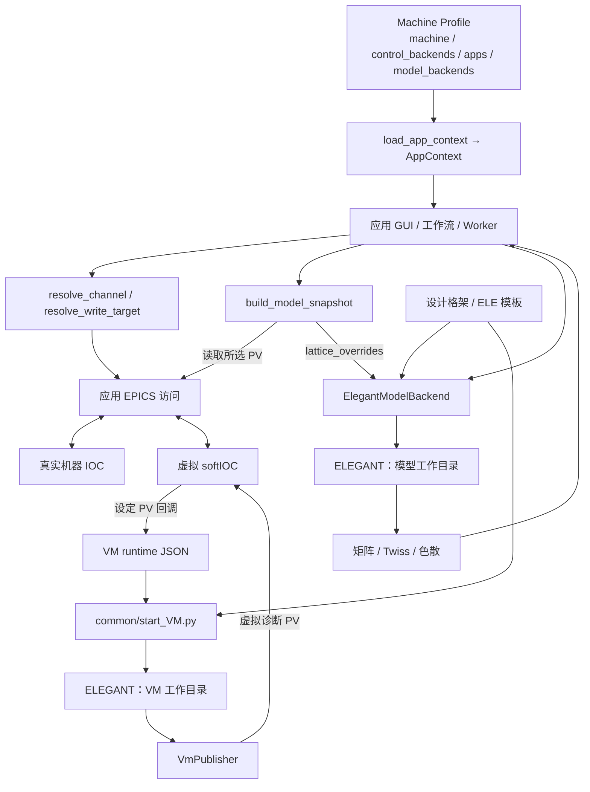
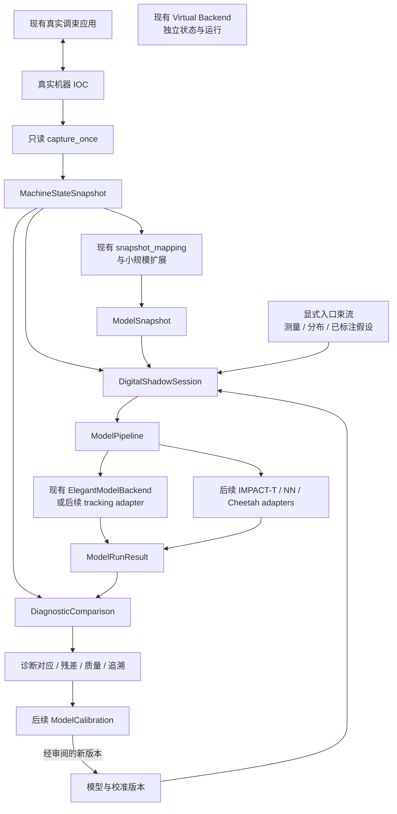

# HALF INJECTOR-DT 数字影子架构审查

状态：**第一阶段离线实现已授权，现场采集待授权**  
审查日期：2026-11-17  
代码基线：`0b5051eb873595509e0e9cbc20eecfba7c231c8c`  
工作分支：`feature/digital-shadow-poc`

`half_linac` 已有真实设备读取与独立 ELEGANT 计算协同的基础。第一阶段宜复用现有采样、参数快照和传输矩阵计算，补充一次工作点的绑定、诊断对应关系及运行追溯。现有 real/vm 控制后端可以保持独立，不需要先改造调束状态机。

2026-11-17 用户已通过第一阶段范围并授权进入离线实现。现场采集、多引擎接入和模型校准不在本次执行范围。第 2 至 7 节保留代码基线的审查结论；第 8 节文件表是原设计建议，实际交付与使用方式见 [离线 PoC 说明](DIGITAL_SHADOW_POC.md)。

## 1 评审范围与资料关系

审查对象为当前后端装配、任务编排、EPICS 访问、VM 状态、模型计算、快照和缓存，以及扩展数字影子和多引擎流水线的路径。结论来自基线源码和配置的静态检查；未启动 GUI、IOC、VM、ELEGANT，未访问真实 PV，也未执行测试。

- [HALF_DT_HANDOFF.md](HALF_DT_HANDOFF.md) 保存项目背景和此前物理研究交接原文。其中历史研究、物理假设和外部软件能力未在本次源码审查中独立验证。
- 本次第一阶段以现有 ELEGANT 概念验证为目标；长期保留 `IMPACT-T / NN → L01B 出口 → ELEGANT / Cheetah`。交接说明中优先 Cheetah 的路线不改变本次第一阶段范围。
- 现有契约参考：[模型快照设计](../platform/MODEL_SNAPSHOT_DESIGN.md)、[Machine Profile 原则](../platform/MACHINE_PROFILE_PRINCIPLES.md)、[配置目录说明](../../configs/machines/README.md)。实现时应先核对这些契约，避免重复建设。
- GOTAcc 和外部维护的 jitter_analysis 不纳入本次架构改造范围。运行产物不作为源码能力成立的证明。

## 2 当前后端与模块职责

### 2.1 控制后端与模型后端

| 概念 | 实际代码与配置 | 职责和限制 |
| --- | --- | --- |
| 控制后端选择 | [models.py](../../src/shared/machine_profile/models.py#L185) 的 `ControlBackendConfig(name)`、`AppContext.control_backend` | 配置对象，本身没有设备读写方法 |
| Real Backend | [real.json](../../configs/machines/half/control_backends/real.json)、resolver 和应用 EPICS 访问代码 | 通过映射访问实机 PV；主体代码没有统一 `RealBackend` 类 |
| Virtual Backend | [vm.json](../../configs/machines/half/control_backends/vm.json)、softIOC、VM JSON、VM 计算进程 | 一套有状态的虚拟控制系统；没有统一 `VirtualBackend` 类 |
| 模型配置 | `ModelBackendConfig(name, engine, config)`、`AppContext.model_backend` | 独立于控制目标的选择维度 |
| 模型协议 | [model_backend.py](../../src/shared/machine_profile/model_backend.py#L116) 的 `BeamModelBackend`、`EnergyModelBackend` | 描述矩阵、Twiss、色散等计算能力 |
| 模型实现 | 同文件 `ElegantModelBackend`、`build_model_backend()` | 工厂目前只实现 `engine == "elegant"` |
| 应用局部机器接口 | [machine/base.py](../../src/apps/dispersion_correction/machine/base.py#L9) 的 `MachineInterface` | 由 `EpicsMachine`、`OfflineMachine` 实现，只服务色散校正 |

`OfflineMachine` 是色散应用的离线模拟实现，不能等同于 softIOC/ELEGANT Virtual Backend。`energy_buttons.control` 中的 `EpicsBackend`、`DemoBackend` 也是应用局部实现。

`ElegantModelBackend` 主要公开接口包括：

```text
get_model_lines / get_measurement_model_line
get_line_elements / get_lattice_element
get_map / get_matrix_element
get_twiss1 / get_twiss_profile / get_full_twiss_profile
get_design_twiss_profile / get_optics_profile
get_energy_dispersion / get_energy_optics
```

`get_map()` 接受 `lattice_overrides`、端点关系 `seq` 和 `twiss_only` 等参数。覆盖值形如 `{"QT02": {"K1": 1.8}}`，使用模型原生字段。

### 2.2 当前架构图



虚拟控制路径将设备状态变化转换为诊断 PV；独立模型路径根据显式参数计算并返回结果。真实状态驱动模型不需要先写入活动 Virtual Backend。

## 3 装配与实际调用链

### 3.1 后端选择与 GUI

[loader.load_app_context()](../../src/shared/machine_profile/loader.py#L172) 分别解析 `control_backend` 和 `model_backend`，同一上下文可以同时持有 `real` 控制后端和 `simulation/elegant` 模型后端。

当前 `MODEL_APP_NAMES` 包括 BBA、发射度、能谱、色散校正、能量反馈等应用。`orbit_correct`、`solenoid_centering` 的装配路径明确不保留模型配置。这是应用装配限制，不是模型依赖 VM 的要求。

`load_model_context()` 已提供模型独立装配入口，但其 `control_backend` 固定为 `vm`。该字段不代表启动 VM，也不能直接作为未来实机数字影子的来源标签。

[Control Room](../../src/apps/launcher/main.py#L1794) 通过环境变量向子进程传递 machine/backend；`_apply_runtime_selection()` 要求先停止管理中的子进程。共享 [runtime_selector.py](../../src/shared/machine_profile/runtime_selector.py#L53) 的应用内切换通过进程重启实现。因此正常 GUI 一次选择一个控制目标，但没有全系统 real/vm 互斥锁。

### 3.2 Task Engine 和状态机

在本次检查的主体源码中未发现统一 `TaskEngine`、`TaskBuilder`。对应职责分布如下：

| 职责 | 已有实现 |
| --- | --- |
| GUI 参数构建 | BBA `get_setting()`、`get_setting_bba2()` |
| 工作流配置构建 | 色散校正 `load_profile_run_config()` → `RunConfig` |
| 任务执行 | `BBAScanThread`、`BBAScanThreadBBA2`、`RFPhaseBatchRunner`、`AchromatWorkflow` |
| 调能阶段编排 | [EnergyTuningPipeline.run()](../../src/shared/energy_tuning/stages.py#L55)，通过 `EnergyStageContext` 回调执行阶段 |
| 反馈安全状态 | [FeedbackSafetyStateMachine](../../src/apps/energy_feedback/safety.py#L18)，管理采集、反馈意图、写许可和 HOLD 等状态 |
| 其他局部状态机 | `magnet_cycle.model.Cycle`、RF 批量流程和各应用 GUI 状态 |

`EnergyTuningPipeline` 是调能流程编排，不是物理引擎流水线。能量反馈 `evaluate_shadow()` 的 `SHADOW` 是反馈建议状态，也不是完整加速器数字影子会话。

第一阶段可在现有调束状态机之外执行，不需要修改这些状态机。

### 3.3 EPICS 读写

```text
GUI / 工作流
  → AppContext
  → resolve_channel / resolve_write_target
  → real 或 vm PV 名
  → epics.PV.get/put、caget/caput 或应用局部客户端
```

[resolver.py](../../src/shared/machine_profile/resolver.py#L68) 按设备 ID、逻辑通道和 backend 解析 PV；`resolve_write_target()` 进一步解析写入物理量、单位和限制。它不是通用的电流到物理模型参数转换器。

写入安全分布在 [write_control.py](../../src/shared/machine_profile/write_control.py#L14) 的 workflow 许可、通道限值、应用读回确认与回退、部分工作流控制锁中。不存在一个由该模块统一截获所有 EPICS 写操作的总入口。数字影子应使用仅暴露读取能力的采样路径，不调用现有调束写入流程。

### 3.4 虚拟设备状态

[mainIOC.main()](../../src/softIOC/mainIOC.py#L149) 执行：

```text
pv_server
  → gen_substitution_file
  → prepare_initial_pvs
  → 启动 softIOC
  → init_lattice_pv
  → monitor_json
```

[pv_server.prepare_initial_pvs()](../../src/softIOC/pv_server.py#L265) 建立 `PV → (element_id, lattice_field)`。`monitor_json()` 注册 PV 回调，经 `_update_element_from_pv()` 和 `update_runtime_state()` 更新 VM JSON。当前桥接主要覆盖 `quad.k1 → K1`、`corr.kick → KICK`、`bend.angle → ANGLE`。

[common/start_VM.main()](../../src/virtual_machine/common/start_VM.py#L209) 读取 JSON，计算 `input_version()`，冻结本次输入，调用 `_update_vm_outputs()` 转换格架并运行 ELEGANT。随后 `VmPublisher` 发布 BPM、屏幕和 ICT 诊断，并由 `collect_results()` 写入 workbench 结果及状态。

虚拟设备状态由 softIOC PV、VM JSON 和修改它们的 IOC/VM 工具共同维护。`ElegantModelBackend` 不管理虚拟设备状态。[runtime_state.py](../../src/shared/runtime_state.py#L70) 的文件锁与原子替换保障 JSON 更新完整性，不保障整机物理时间一致性。

### 3.5 独立模型计算与现成协同实例

```text
build_model_snapshot(context, requested_fields)
  → snapshot_mapping
  → resolve_channel
  → pv_reader，默认 caget
  → 参数转换
  → ModelSnapshot.lattice_overrides

build_model_backend(context)
  → ElegantModelBackend
  → 设计格架与 ELE 模板
  → 应用 overrides
  → 模型专用 JSON/LTE/ELE
  → run_elegant_input
  → 读取 SDDS
  → 矩阵 / 光学结果
```

| 应用 | 实际调用关系 | 已实现范围 |
| --- | --- | --- |
| [BBA2](../../src/apps/bba/main.py#L3925) | `_build_bba2_model_snapshot_metadata()` → `_try_build_model_backend()` → `_calculate_model_r12()` | 读取 K1 后计算模型响应 |
| [发射度](../../src/apps/emit_measure/main.py#L3266) | 从模型路径推导四极铁字段 → `build_model_snapshot()` → transfer/model 调用 | 局部工作点驱动传输矩阵 |
| [能谱](../../src/apps/energy_spectrum/main.py#L4617) | `cal_disp()` / `cal_twiss_disp()` → 四极铁快照 → energy model 方法 | 当前 K1 驱动色散和 Twiss |
| [色散模型分析](../../src/apps/dispersion_correction/model_response.py#L25) | `calculate_model_response(model_source=...)` → 当前 K1 模型光学 | 模型光学与设计参考比较，不是通用实测诊断比较 |
| [三 BPM 能量重建](../../src/apps/energy_feedback/profile_runtime.py#L452) | `build_measurement_provider()` 读取参考能量、`K1_total` → `build_bpm_transport_model()` → sampler | 局部真实状态驱动模型，并监测 K1 漂移 |

最后一个路径是可复用的“真实状态驱动物理模型”实例，不应重复建设其基础能力。

## 4 状态 映射 快照和缓存

### 4.1 已有公共数据能力

| 能力 | 当前实现与边界 |
| --- | --- |
| 设备身份 | `MachineProfile`、`ElementConfig.id` 统一应用侧设备标识 |
| 实虚 PV 映射 | `element_id + logical_channel + backend → PV` |
| 模型转换 | `snapshot_mapping`，支持 direct、scale_offset、polynomial |
| 原始设备快照 | [MachineStateSnapshot](../../src/shared/machine_state.py#L90)，包含逐通道时间、报警、质量和采集窗口 |
| 模型参数快照 | [ModelSnapshot](../../src/shared/machine_profile/model_snapshot.py#L28)，包含字段、来源 PV、原始值、转换和单位 |
| 保存与重放 | 两类快照均有序列化；模型快照支持 saved 来源 |
| 局部模型版本 | 发射度匹配模块已有 fingerprint 和文件哈希 |
| 局部计算复用 | 优化内缓存、multi-screen 局部重算、VM 最近结果 |
| 通用持久结果缓存 | 尚无统一实现 |

原始设备快照保存证据，模型快照保存派生输入。应连接两者，不再建立第三种通用机器快照。

### 4.2 参数映射覆盖与物理语义

HALF [simulation.elegant.json](../../configs/machines/half/model_backends/simulation.elegant.json#L22) 显式列出 37 个 K1 字段，并提供 K1 默认规则；37 不是支持上限。该配置尚未提供完整的校正铁电流到 kick、弯铁状态到模型参数、LLRF 幅相到 RF 电压相位、时序耦合和入口束流映射。

现有转换处理单个标量。多源依赖、参考能量依赖、源设备与目标模型元件不同、一个控制量对应多个物理位置等关系仍需增量扩展。

通用模型快照 K1 默认读取逻辑 `K1`；三 BPM 能量模型则明确要求 `K1_total`。实机 [QL09 配置](../../configs/machines/half/control_backends/real.json#L701) 同时提供 `K1`、`K1_adj`、`K1_total`。用户于 2026-11-17 确认：`K1` 是四极铁归一化强度设置值，`K1_total` 是归一化强度回读值，二者单位均为 ELEGANT 使用的 `1/m^2`。数字影子将 real `K1_total` 映射为模型 `K1`；原始快照保留设置值，不修改其他应用的默认规则。

### 4.3 模型元件身份与重复位置

现有快照通常假设设备 ID 与模型元件名一致。实机 RF 使用 `LLRF01` 等 ID，而格架使用 `L1`、`L2`、`L4` 等定义；同一定义在束线上重复出现。`get_map()` 等端点查询使用 `usedline.index()`，按名称覆盖作用于同名定义。

未来必须在需要的位置区分设备 ID、模型元件定义、occurrence 和 entrance/exit。光学输出已有 `element_occurrence`，VM workbench 也用 index 区分位置，可以复用其思路。

本次检查的格架没有可直接确认的唯一 `L01B` 交接端点。`BL01B` 是弯铁；[RF 定义及束线](../../src/virtual_machine/half_elegant/elegant/lattice_ini.lte#L400) 使用重复的 `L1` 等名字。多引擎接入前须明确 L01B 出口的唯一位置、参考能量及坐标约定。

### 4.4 快照与时间一致性

[sample_capture_points()](../../src/shared/pv_sampling.py#L37) 已有总超时、PV 去重、主动读取、质量记录和取消支持，但按 PV 顺序采样，不能保证原子或同脉冲一致性。

- `MachineSnapshotWindow` 的采集结果标记 `consistency="best_effort"`。
- 当前采样器排除数组；屏幕图像不能直接通过此标量快照保存。
- 默认 capture groups 不包含 observations。
- `K1_total` 分类为 DERIVED，默认计划不能假定包含它。
- `ModelSnapshot` 没有逐字段 EPICS 时间、报警、完整采集窗口或统一模型版本绑定。

先采机器快照、再让 `build_model_snapshot()` 默认 caget，会产生第二次取样。数字影子应从原始快照构造模型快照；现有可注入 `pv_reader` 已提供一个复用入口，质量和来源校验仍需补齐。

另一个来源风险是显式 `source="live_from_real"` 按 real 读取，而返回的 `control_backend` 仍取 context。新会话入口应要求来源一致，以防实际读取与标签不符。

[compare_snapshots()](../../src/shared/machine_state.py#L349) 对不同 backend 返回 `NOT_COMPARABLE`，不算差值。数字影子需要独立诊断比较器，保留原快照比较语义。

### 4.5 模型状态与副作用

| 项目 | 源码行为 | 数字影子影响 |
| --- | --- | --- |
| 文件写入 | 每次生成 JSON/LTE/ELE、日志及模型输出 | 模型调用不是无副作用纯函数 |
| 共享工作目录 | optics、energy 使用固定文件名 | 不天然保存每次计算历史 |
| 工作区锁 | `_exclusive_model_workspace()` 跨进程互斥，默认等待 30 秒 | 保留已有保护；等待超时不是计算超时 |
| 对象可变状态 | `energy_mev` 可变；`get_full_twiss_profile()` 临时修改后恢复 | 不宜让多个任务共享同一 backend 实例 |
| 元素线路缓存 | `_model_lines` 缓存在对象中 | 没有通用的模型变化失效机制 |
| SDDS 资源 | 读取使用 `SDDS(0)` | 同进程跨工作目录并发安全尚待验证 |
| 外部计算 | [run_elegant_input()](../../src/shared/elegant_runtime.py#L7) 同步运行并检查返回码 | 已有异常；没有计算超时与取消接口 |

[模型准备路径](../../src/shared/machine_profile/model_backend.py#L589) 还有影响物理含义的行为：先清零已有 KICK、部分错位与旋转，禁用部分 WATCH，然后应用显式 overrides。`twiss_only=True` 删除部分 wake 字段及束流生成和 tracking。

`energy_mev` 只在选中段包含加速元件的特定路径中用于重设 `p_central`；energy 专用路径没有统一应用该参数。因此传入能量不等于所有调用路径的入口动量都正确。HALF [模型 ELE 模板](../../configs/machines/half/model_backends/elegant/optics_ini.ele#L50) 的束流生成设置为一个粒子，不能直接将其当作完整束团诊断预测器。

模型可以不运行 VM/IOC 而使用，但导入仍依赖 sdds，并经 `elegant_backend.__init__` 引入 EPICS publisher。依赖整理可后置；实际计算无需通过 publisher 发布 PV。

### 4.6 已有结果与版本能力

- [workbench_data.input_version()](../../src/virtual_machine/workbench_data.py#L13) 对 VM 输入求哈希；`collect_results()` 检查输出新鲜度，保存有输入版本的最近结果。这不是持久多版本缓存。
- [ElegantMatchingModel](../../src/apps/emit_measure/matching_model.py#L20) 保存模型文件哈希、求值格架和 fingerprint，`assert_unchanged()` 检查变化。
- `emit_measure/matching.py` 在一次优化内按参数缓存模型 profile。
- [rebuild_multi_screen_optics()](../../src/apps/emit_measure/multi_screen.py#L636) 重算调用方指定观测点，复用其他矩阵；没有通用的依赖自动失效图。

这些机制应复用，但尚不能替代统一的模型依赖版本、缓存键、运行索引和结果归属。

## 5 真实与虚拟协同能力评估

| 问题 | 状态 | 结论 |
| --- | --- | --- |
| real/vm 是否只能二选一 | 单上下文控制目标单选 | 常规 GUI 选择一个目标；不是系统级互斥 |
| 同一任务读实机并调用模型 | 已有局部功能 | BBA、发射度、能谱及三 BPM 重建已有结构 |
| 同一任务同时操作 real 和 VM | 通用编排缺失 | 可显式解析两套 PV；数字影子第一阶段不需要双目标操作 |
| 模型独立于 Virtual Backend | 已有功能 | 配置、设计文件和 overrides 足以调用，无需运行 VM/IOC |
| 根据真实 PV 生成完整输入 | 部分支持 | 局部 K1 可用；完整 RF、磁场与入口束流映射缺失 |
| 同工作点实虚诊断比较 | 有基础，通用能力缺失 | 缺少统一的会话绑定、时间判据和诊断投影 |
| 后端切换是否阻碍会话 | 不是根本障碍 | 避免依赖切换和重启；固定 real 控制目标，独立调用模型 |
| 是否必须改调束状态机 | 当前无此必要 | 单次只读数字影子可位于现有工作流之外 |
| 实机映射和物理精度 | 待验证 | 静态配置和 mock 测试不能证明现场语义与预测精度 |

## 6 推荐目标架构

保留现有控制后端，在旁边增加只读会话层，绑定原始状态、模型输入、版本和结果。会话不接管调束执行。



| 候选模块 | 处理建议 |
| --- | --- |
| MachineSnapshot | 复用 `MachineStateSnapshot` |
| MachineStateManager | 第一阶段采用 capture 与校验函数，不引入长期状态管理器 |
| ParameterMapping | 复用 resolver、snapshot_mapping、转换；补来源选择与覆盖检查 |
| ModelPipeline | 新增薄编排；保留 ElegantModelBackend 作为 ELEGANT 光学适配器 |
| DigitalShadowSession | 新增一次输入、一次计算、一次比较的绑定；首版可用函数式入口 |
| TwinSession | 校准和辅助调束生命周期明确后扩展 |
| DiagnosticComparison | 新增诊断身份、单位、位置和质量对齐 |
| ModelCalibration | 后续新增通用流程；复用已有能量旋钮标定和束流矩阵重建能力 |

第一阶段不统一重写各应用的设备接口，不引入新的调束 Task Engine，不修改 EPICS 写入安全机制。

## 7 多引擎接口预留

`ElegantModelBackend` 适合保留为流水线适配器。其接口包含 ELEGANT 原生字段和光学操作，不宜直接承担所有引擎的公共语义。

以下为拟新增契约，不是当前 API：

```text
ModelRequest
  machine_snapshot_id / hash
  model_snapshot
  beam_input
  segment / boundary
  requested_diagnostics
  model_version / calibration_version
  fidelity / seed

ModelPipeline.run(request) → ModelRunResult

ModelRunResult
  run_id / input_hash
  engine及资源版本
  diagnostics
  beam_output（能力允许时）
  artifacts
  status / failure
```

目标链为 `IMPACT-T / NN → L01B 出口 BeamState6D → ELEGANT / Cheetah`。IMPACT-T 与 NN 是可切换选择，不要求每次同时运行。

| 要求 | 可复用基础 | 增量工作 |
| --- | --- | --- |
| 输入转换 | resolver、标量转换、字段覆盖 | 多源映射、能量依赖、有效域、引擎适配 |
| 六维交换 | [beam_source.py](../../src/virtual_machine/beam_source.py#L14) 的 sdds_beam、parser 输出 | 公共束流契约、坐标变换和文件版本 |
| 模型切换 | ModelBackendConfig.engine、工厂位置 | adapter 注册、能力检查和统一结果 |
| 局部重算 | 分段矩阵、multi-screen 局部重算 | 按上游依赖自动失效、阶段边界缓存 |
| 快照与版本 | snapshot ID、profile signature、局部 fingerprint | 运行 manifest 和完整依赖版本 |
| 异步与失败 | Worker、VM 后台进程、返回码异常 | 超时、取消、过期结果处理和重试规则 |
| 缓存追溯 | 输入哈希、局部缓存及归档 | 持久索引、全输入缓存键和失效策略 |

六维束流契约至少记录边界位置、坐标系、粒子种类、质量电荷、参考动量或能量、参考时间、粒子权重与损失、来源工作点和引擎版本。统计矩表示应明确均值、协方差及未表达的分布信息。

公共坐标候选为 `[x, px/p_ref, y, py/p_ref, c(t-t_ref), (p-p_ref)/p_ref]`，尚待物理评审。各引擎必须显式转换；不能把当前 ELEGANT 6×6 矩阵直接当作该坐标矩阵。统计矩也不能无条件恢复非高斯粒子分布。

缓存键应覆盖完整模型输入、入口束流、边界与观测请求、引擎版本、格架和模板及引用资源哈希、校准版本、精度和随机种子。第一阶段先保证归属与追溯，不急于实现通用缓存或复杂调度图。

## 8 第一阶段最小概念验证

### 8.1 目标与计算范围

从真实机器读取一次工作点快照，驱动现有 ELEGANT 计算，并对应比较预测诊断与实际诊断。先支持保存快照的离线重放；现场读取须在方案通过并得到现场操作授权后进行。

优先选择无 RF、低耦合且诊断可用的局部束线。已有发射度路径和 [PRF06 至 PRF09 配置](../../configs/machines/half/apps/emit_measure.json#L121) 可作为候选；段落尚未选定。第一阶段不要求实现预注入器引擎、NN 或 Cheetah。

设备 PV 不能唯一确定入口六维束流。入口横向束流矩应来自独立既有测量，或明确标注的模型假设。使用诊断拟合入口条件后再比较同一诊断只能视为拟合残差；预测验证需使用独立数据或留出的诊断。

### 8.2 单次执行流程

1. 明确 reference 的 entrance/exit、目标诊断、入口束流来源与适用假设。
2. 以同一批有界采样读取所需状态、有效强度、能量参考和实际标量诊断；显式补充 required derived 与 observation 通道。
3. 检查必要输入质量、单位、报警及采集窗口，保留 best_effort 一致性标签。区分设备最后更新时间和新鲜诊断采样时间。
4. 仅从原始快照派生 ModelSnapshot，不再次读 PV；记录所用 K1 或 K1_total。
5. 派生独立运行目录与模型配置，使用现有 `get_map(..., lattice_overrides=..., twiss_only=True)`。
6. 传播独立入口束流矩，提取预测束斑尺寸。
7. 对齐同位置、同定义的实际诊断，输出 residual = measured - predicted、质量及适用范围。
8. 归档原始快照、派生输入、入口束流、模型版本、计算产物、结果和报告。

[transport_beam_moments()](../../src/shared/beam_matrix.py#L572) 已实现二维 `Σ_out = R Σ_in Rᵀ`，可直接复用。无色散和无耦合近似须明确；不满足条件时扩展六维协方差传播。

`sigx/sigy` 的单位、RMS/FWHM、ROI、背景处理和有效性必须确认。当前标量快照排除图像数组；首版不应把图像采集混入既有标量快照契约。

### 8.3 建议文件和接口

| 文件 | 建议变更 |
| --- | --- |
| 新增 `src/shared/digital_shadow/capture.py` | `capture_once(profile, backend, points, timeout_s) -> MachineStateSnapshot`；复用采样和数据类 |
| 小改 `src/shared/machine_profile/model_snapshot.py` | 新增 `build_model_snapshot_from_machine_state(...)`；复用映射转换，补来源和质量校验，禁止隐式重采样 |
| 新增 `src/shared/digital_shadow/pipeline.py` | 首版只实现 ELEGANT 矩阵请求；按运行派生配置和输出路径 |
| 新增 `src/shared/digital_shadow/comparison.py` | 对齐物理诊断身份、位置、单位与定义，生成实测、预测、残差和质量 |
| 新增 `src/shared/digital_shadow/session.py` | `run_once(...)` 连接采集、转换、计算、比较及归档 |
| 新增 `scripts/run_digital_shadow.py` | 离线重放优先；实机采集显式选择；不提供写 PV 接口 |
| 小改 `src/shared/elegant_runtime.py` | 可选计算超时，保持旧调用默认行为 |
| 数字影子专用配置 | 仅存段落默认值、诊断语义、入口来源及必要映射覆盖；元素列表按 profile 和路径推导 |
| 针对性测试 | 不重采样、只读、有效强度选择、目录隔离、对齐和失败不复用旧结果 |

会话级映射覆盖按用户确认的语义，将模型 K1 取自 real K1_total，不修改其他应用的默认 K1 规则。离线 PoC 通过独立配置和冻结 ELE 显式设置参考动量；`model_backend.py` 只增加可选超时传递。

## 9 分阶段计划与验收

| 阶段 | 范围 | 验收 |
| --- | --- | --- |
| 一 单次概念验证 | 保存快照重放；审阅后现场显式读取一次；ELEGANT 局部预测和比较 | 只读、不重采样、结果绑定唯一 snapshot/run、质量明确、可重放 |
| 二 持续数字影子 | 周期采样、漂移判据、后台作业、新鲜度和缓存 | 过期结果不冒充当前预测；版本变化使缓存失效；失败不影响现有调束 |
| 三 多引擎 | L01B 六维契约及 IMPACT-T/NN、ELEGANT/Cheetah 适配 | 坐标、单位与边界量通过基准验证；能力差异有说明 |
| 四 在线模型校准 | 参数辨识、独立验证、模型发布与回退 | 改善独立数据；记录有效域和不确定度；版本可重放回退 |
| 后续辅助调束 | 经审阅的模型建议接入既有流程 | 继续通过现有写许可、限值、确认与回退 |

第一阶段分开验收工程链路和物理精度。工程链路要求必要输入失败即停止计算，单位或身份不一致不做减法，模型只使用同一次采样数据，运行目录和产物归属唯一。物理精度要求入口条件、诊断定义和测量不确定度确认后再约定残差容差；软件运行成功不代表物理模型已准确。

| 风险 | 处理与验证 |
| --- | --- |
| K1 与 K1_total 语义 | 核对 IOC 和物理定义，保存来源及转换版本 |
| 采集期间机器变化 | 保存窗口、时间与质量；不能证明一致时标记限制 |
| 入口束流未知 | 使用独立测量或显式假设 |
| 模型清零误差或禁用 tracking | 限定首阶段适用范围；完整预测后续显式增加模式 |
| 入口动量不正确 | 核查生成 ELE 与选定调用路径 |
| 固定目录和旧输出 | 独立运行目录、完整性与归属检查 |
| SDDS 并发和可变 backend | 首阶段独立计算进程，再验证并发 |
| 诊断处理不一致 | 固化单位、方法、位置、坐标和校准 |
| 模型资源运行中改变 | 保存资源版本及哈希；变化使结果无效 |

已有 `tests/test_machine_profile.py`、`tests/test_machine_state.py`、`tests/test_pv_sampling.py`、`tests/test_elegant_backend.py`、`tests/test_emit_multi_screen.py`、`tests/test_vm_workbench.py` 可作为回归基础。本次未执行测试；现场 PV 语义、ELEGANT 数值精度、SDDS 并发和 L01B 物理边界仍待验证。

## 10 评审决定与待确认事项

### 10.1 决定记录

| 日期 | 事项 | 状态与范围 |
| --- | --- | --- |
| 2026-11-17 | 完成当前代码架构静态审查 | 报告已交付；不等于架构获批 |
| 2026-11-17 | 独立 worktree 和分支 | 用户已授权；路径 `../half_linac-dt`，分支 `feature/digital-shadow-poc`，基于上述代码基线 |
| 2026-11-17 | 评审材料入库 | 用户已授权；纳入交接说明与本报告，原工作区资料保持原样 |
| 2026-11-17 | 第一阶段范围与离线实现 | 用户已授权；复用现有快照和 ELEGANT，保持后端与调束状态机独立 |
| 2026-11-17 | 四极铁强度语义 | 用户确认 K1 为设置值、K1_total 为回读值，单位均为 1/m^2；real 数字影子使用回读值 |
| 2026-11-17 | 第一阶段离线 PoC | 已完成保存快照重放、独立 ELEGANT 计算、诊断比较与追溯；验证和限制见 PoC 说明 |
| 待定 | 现场只读采集 | 待方案和现场操作授权；本次没有连接机器 |

原工作区 `docs/DT/` 中的物理输入、压缩包、PDF 和其他附件未纳入本次文档提交。迁移到本分支的交接说明保留原文，不能将其中历史“已确定”表述当作本次架构方案获批。

### 10.2 已确认与待核实事项

1. 已确认采用独立只读会话、复用两类快照并保留现有 real/vm 独立性的方案。
2. 第一阶段局部段落、reference 的 entrance/exit 与独立诊断。
3. 入口束流资料来源、时效和适用条件。
4. K1 设置值与 K1_total 回读值的选择已确认；K1_adj 的独立物理用途不在首阶段范围。
5. 实际诊断的单位、RMS 定义、质量与时间判据。
6. 工程验收与物理精度验收的分别要求。
7. L01B 出口的唯一模型位置与六维契约，留待多引擎阶段确认。

### 10.3 后续工作入口

在 `/home/zhanghaoran/gitproj/half_linac-dt` 工作，先检查 `git status --short`、当前分支和本文状态。第一阶段离线实现按 [PoC 说明](DIGITAL_SHADOW_POC.md) 验证；下一步核实真实入口束流和诊断资料，再安排明确授权的现场只读采集。保持调束状态机和 EPICS 写入机制不变。

源码变动后，应按本报告基线重新核对受影响结论；拟新增接口不可当作已存在 API 使用。
