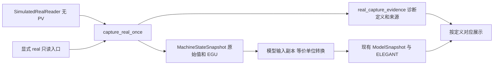

# HALF real 只读采集离线实现与验收

2026-11-18，在没有真机条件下，已实现 real 一次只读采集器、显式 CLI/GUI 入口、无 PV 离线演练和带来源的归档重放。开发与验收均未连接实机，没有改变现有调束状态机、EPICS 写入安全机制、机器 PV 映射或运行中的 VM/IOC 文件。

## 无需真机或 VM 的 GUI 演练

从数字影子专用工作区启动 Control Room，打开 Digital Shadow 后：

1. 模式选择 **Offline real capture demo · NO PV**。
2. 点击 **Load real demo**，填入明确标记为 SYNTHETIC 的四屏请求。
3. 点击 **Run offline real demo**。
4. 查看 PRF06/07/08/09 两平面预测、原始观测定义和归档；History 的 **Use archived inputs for replay** 可再次离线计算。

该模式不需要 softIOC 或 VM。它通过注入的 Python 读取器走正式采集器、快照和 ELEGANT 流程，归一化强度、入口束流和观测值均是演示输入，界面和快照保留 SYNTHETIC 标记。

正常演练结果为 `prediction_status=complete`、总状态 `partial`，八项比较为 `incompatible`，残差留空。这表示工程预测完成，而高斯 σ 或定义未知的观测不能作为 RMS 精度比较；不是计算失败，也不是实机验收通过。图中明确区分 Predicted RMS 与 Observed gaussian_sigma/unknown，纵轴使用 Width，避免把观测统一标成 RMS。

## 实际接口与调用链



- [real_capture.py](../../src/shared/digital_shadow/real_capture.py) 的 `build_real_capture_plan()` 按 `kind=quad` 动态检查全机设备，`capture_real_once()` 复用 `sample_capture_points()`，`verify_real_evidence()` 绑定快照与诊断来源，`normalized_real_input()` 生成模型单位副本。
- [real_demo.py](../../src/shared/digital_shadow/real_demo.py) 的 `SimulatedRealReader` 和 `capture_demo()` 只替换读取器，不旁路采集、单位、快照或模型逻辑。
- [session.run_once()](../../src/shared/digital_shadow/session.py) 接收可选 `real_evidence`，冻结原始输入，再调用现有模型快照转换和 pipeline；后续计算不补读 PV。
- [comparison.py](../../src/shared/digital_shadow/comparison.py) 将观测定义与模型 RMS 分开。有效但定义不兼容的观测保留数值、空残差和原因；过期、报警、错误单位等观测保留不可用原因。
- [机器诊断事实](../../configs/machines/half/apps/digital_shadow.json) 仅保存单位、测宽定义及确认来源，没有重复维护可选设备列表；未知测宽定义不自动变成 RMS。

当前全机目标 68 块四极铁，其中 66 块具有有效 K1/K1_total 配置，默认四屏任务采集 132 项归一化状态及 8 项束宽，共 140 项。QDU01/02 缺项单列，不采电流兜底。当前局部模型只消费 QT01～QT04 四项回读，无关段的坏数据保留在全机快照中，不作为设计值或设置值替代。

采集在原共享窗口内优先读取模型必要回读，再读所选诊断、其余全机状态；每个 PV 最多读一次。无关 PV 断开不会先耗尽必要回读的读取机会，不延长窗口。快照仍标记 sequential_read_window，不声明原子采样、四屏同束团或机器稳定性已证明。

## 单位、来源与失败处理

原始 SnapshotEntry.unit 保存实际 EGU，不写入规范化值掩盖来源。只有 `1/m^2`、`m^-2`、`1/m²`、`m⁻²` 被识别为本阶段的等价强度单位；必要模型输入通过副本规范到 `1/m^2`，转换前后单位和 scale=1 单独归档。

`machine_snapshot.json` 保存原始快照，`model_input_snapshot.json` 保存派生副本，`real_capture_evidence.json` 保存读取器类型、缺失四极铁、诊断定义和单位来源。manifest/input_hash 包含这些证据及规范化记录。原始 EGU、源时间、接收时间、报警、count 和质量不被假装成另一种来源。

PRF06/08 保留已确认的高斯拟合 σ；PRF07/09 单位已确认 mm，算法定义尚未进一步确认时按 unknown 保存。真实 SIZE 通道不允许通过元数据改标为粒子 RMS；未来图像派生 RMS 仍需要独立来源适配。

必要回读缺失、非等价或缺少单位、数组、报警、未来时间或映射冲突时，在 ELEGANT 之前失败，并保存失败 manifest 和已经采集的输入。新 real 快照没有配套来源证据时不能重放；旧 real 档案继续只读查看。原有 VM/real 后端仍独立，`run-vm` 继续拒绝 real。

## CLI 与显式真实读取

离线生成请求并演练：

```bash
python3 scripts/run_digital_shadow.py example --real-demo --output-dir runs/real_demo_inputs
python3 scripts/run_digital_shadow.py demo-real \
  --request runs/real_demo_inputs/request.json --output-root runs/real_demo
```

定义不兼容时 CLI 返回 2（partial），不是 1（failed）。对生成的 run 可使用原 replay 子命令加 `--real-evidence <run>/real_capture_evidence.json` 重放，无需连接任何设备。

将来有现场条件时，CLI `run-real` 必须显式传 `--connect-real`；API 原生读取必须 `allow_live=True`。GUI 选择 **Real · capture once · READ ONLY** 后，只有点击 **Read real PVs & predict** 才执行。启动器的 real 环境值、启动窗口或切换模式都不会自动采集；带 SYNTHETIC 入口来源的演示请求会被拒绝用于 live capture。

本轮没有运行带授权标志的原生 real 读取，没有验证现场连接性、实际部署 EGU、诊断帧时间语义或独立入口束流。缺少硬件不阻碍本次离线实现，后续硬件验证仍须在具备条件且明确授权时进行。

## 验收记录

- 85 项定向回归通过，覆盖原有 VM/GUI、real 读取一次、全机与局部范围分开、坏单位/报警/断连/数组/未来时间、来源篡改、无电流回退、显式连接门槛及 CLI 请求生成。real 模式的诊断选项由真实映射推导，不依赖 VM 是否提供同名束宽通道。
- 7 项 ELEGANT/GUI 集成通过，覆盖 real 演练及重放、原 VM 单屏与四屏采集、停止/关闭和启动器进程清理；real 演练在父进程与 worker 中禁止 PV API。
- 原始 m^-2 快照不变，四个模型必要回读的转换记录存在；演练与归档重放 input_hash 及比较结果一致，未授权 CLI real 命令被拒绝。
- 仓库静态检查通过。当前 VM/IOC 运行文件哈希不变；没有声明实机物理精度通过。

验收产物、日志、合成快照和 GUI 截图保存在 [runs/digital_shadow_real_offline/20261118](../../runs/digital_shadow_real_offline/20261118/)，由既有忽略规则排除。复验入口为 `tests/test_digital_shadow_real.py`、`test_digital_shadow_real_gui.py` 和 opt-in 的 `test_digital_shadow_real_integration.py`；最后一项需设置 `HALF_SHADOW_REAL_DEMO_INTEGRATION=1`。
